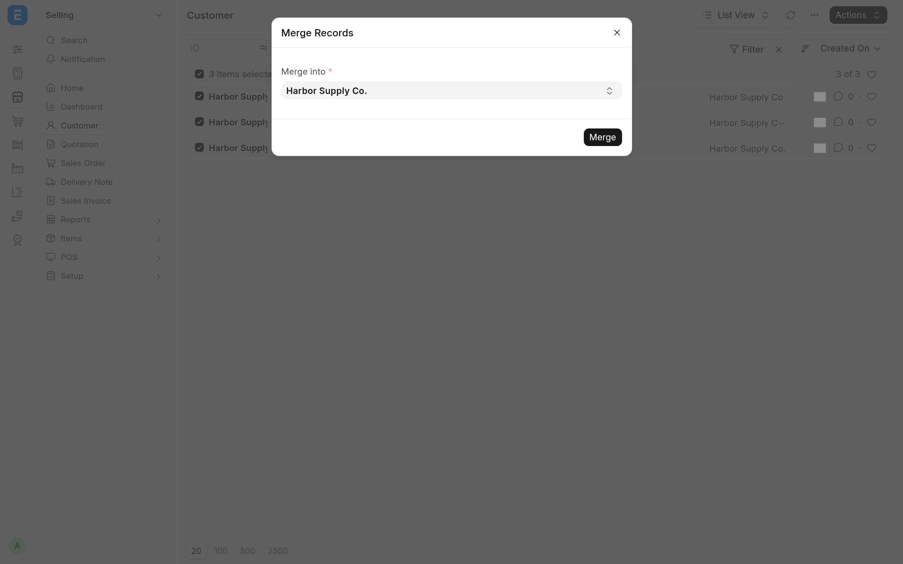

<!-- Copyright (c) 2026, Avunu LLC and contributors
For license information, please see license.txt-->

<!-- frappe-nix:begin header -->

<div align="center">


# Data Steward

Merge duplicate records, convert Items to variants and fix bank clearance dates

[](https://github.com/Avunu/data_steward/actions/workflows/ci.yml)
[](https://github.com/Avunu/data_steward/releases)
[](license.txt)
[](https://github.com/frappe/frappe/tree/version-16)

<picture>
  <source media="(prefers-color-scheme: dark)" srcset="docs/screenshots/merge-records-dark.webp">
  
</picture>

</div>

<!-- frappe-nix:end header -->

## Overview

Frappe and ERPNext make some corrections hard on purpose: a duplicate Customer can't simply be folded into another, an Item can't become a variant once it exists, and a clearance date that bank reconciliation got wrong can't be changed on a submitted entry. Sometimes an administrator cleaning up real data does need to make those changes. Data Steward adds a small set of tools for them.

Installing the app switches none of the tools on. Each one stays off until a System Manager enables it in **Data Steward Settings**, the server checks that setting again on every call, each tool also needs a role and the user's write permission on the document, and every change leaves a comment on the document it touched. It is meant for experienced administrators; try a correction on a copy of the site first.

## Features

- **Bulk merge.** A **Merge Selected** action in the list view of every DocType that allows renaming: tick two or more records, pick the one to keep, and the others are merged into it with Frappe's own rename-and-merge. System Manager only.
- **Convert an Item to a variant.** **Actions → Convert to Variant** on the Item form: choose a template Item, pick a value for each of its attributes, and the Item becomes a variant of that template. Item Manager or System Manager.
- **Payment Entry clearance date.** A **Set Clearance Date** button on a submitted Payment Entry sets or changes the date in a dialog. As in ERPNext's Bank Clearance tool, the date can't be before the entry's Cheque/Reference Date. Accounts Manager or System Manager.
- **Journal Entry clearance.** **Actions → Manually Clear** on a submitted Journal Entry sets the clearance date to the date of the Bank Transaction the entry is matched to, and refuses it when that date is before the entry's Reference Date (cheque date); **Actions → Remove Clearance** clears it again. Accounts Manager or System Manager.
- **An audit trail.** Every correction adds a comment to the document it changed: the old and new clearance date, the template an Item was converted to, or (Frappe's own) the records merged into the one kept. Data Steward Settings tracks its own changes too.
- **Full-width desk.** The desk uses the full screen width, unless the user has already chosen a container width. This is the one part of the app that is not behind a setting, and it changes no data.

<!-- frappe-nix:begin compatibility -->

## Compatibility

| Frappe | Branch       |
| ------ | ------------ |
| v16    | `version-16` |

| Requires                                     | Version            |
| -------------------------------------------- | ------------------ |
| [erpnext](https://github.com/frappe/erpnext) | `>=16.0.0,<17.0.0` |

<!-- frappe-nix:end compatibility -->

<!-- frappe-nix:begin installation -->

## Installation

```bash
bench get-app https://github.com/Avunu/data_steward --branch version-16
bench --site <site> install-app data_steward
```

<!-- frappe-nix:end installation -->

Data Steward needs ERPNext on the same site.

## Configuration

Open **Data Steward Settings** (search for it in the awesome bar) as a System Manager and tick only the tools you need:

| Setting                  | Tool                                       | Who can use it                   |
| ------------------------ | ------------------------------------------ | -------------------------------- |
| Allow Bulk Merge         | Merge Selected, in renamable list views    | System Manager                   |
| Allow Convert to Variant | Item → Actions → Convert to Variant        | Item Manager, System Manager     |
| Set Clearance Date       | Payment Entry → Set Clearance Date         | Accounts Manager, System Manager |
| Manually Clear           | Journal Entry → Actions → Manually Clear   | Accounts Manager, System Manager |
| Remove Clearance         | Journal Entry → Actions → Remove Clearance | Accounts Manager, System Manager |

Every tool also needs the user's write permission on the document (for a merge, Frappe's rename checks permission on each record). Buttons for a tool that is switched off are not shown, and its endpoint refuses the call.

**Coming from Jailbreak.** Data Steward replaces the earlier `jailbreak` app. It has its own module and its own settings, so both can be installed on a site at once: install `data_steward`, then uninstall `jailbreak`. On install, Data Steward copies the five capability toggles from Jailbreak Settings. Version restore, which `jailbreak` had already disabled, is not part of Data Steward.

## How It Works

- The settings are a Single DocType, **Data Steward Settings**, with one check box per tool, all off by default. `data_steward.api.check_capability` tells the desk whether to show a tool's button; every endpoint starts with `assert_capability`, which raises a permission error when the tool is off, then checks the role and the document permission.
- **Bulk merge** overrides the desk's `ListView` class to add the **Merge Selected** action to DocTypes with **Allow Rename** set (Frappe renames, and so merges, no others), then calls Frappe's `bulk_rename` with the merge flag set for each record, so each one is renamed onto the record you keep and its links follow. Each merge is committed on its own, and Frappe's rename rules apply. When it is done, the list refreshes and a **Merge Log** dialog shows Frappe's line for each record, merged or failed.
- **Convert to Variant** writes `variant_of` on the Item directly (it is a set-once field, so a normal save would refuse it), replaces the Item's attributes with the template's, using the values you picked, and saves the Item. ERPNext's Item validation runs on that save, so a template without variants is refused ("is not a template item") and the request rolls back. When the template's stock UOM differs, the Item takes the template's stock UOM and keeps its old one as the sales UOM.
- **The clearance tools** write `clearance_date` directly on a submitted Payment Entry or Journal Entry. Their buttons are shown only on submitted entries, and the endpoints refuse a draft or cancelled one. **Manually Clear** looks for a Bank Transaction whose payments table links this Journal Entry and uses that transaction's date. Before writing, both apply the rule from ERPNext's Bank Clearance tool: when the entry has a cheque date (`reference_date` on a Payment Entry, `cheque_date` on a Journal Entry), a clearance date before it is refused with "Clearance date … must be after cheque date …", and nothing is written. A clearance date on the cheque date itself is allowed, and the Set Clearance Date dialog's date picker greys out the days before the cheque date.
- The endpoints accept POST only and do not commit themselves: the request commits on success and rolls back on an error.
- On install, `data_steward.install.after_install` copies the capability toggles from Jailbreak Settings when that DocType exists.

## Limitations

- **Clearance changes skip the document's own validation.** The date is checked the way ERPNext's Bank Clearance tool checks it (not before the cheque date), but it is then written straight to the database, so ERPNext does not re-check it against the bank account or the Bank Reconciliation.

<!-- frappe-nix:begin support -->

## Support

- Bug reports and questions: [GitHub issues](https://github.com/Avunu/data_steward/issues)
- E-mail: <mail@avu.nu>

<!-- frappe-nix:end support -->

<!-- frappe-nix:begin development -->

## Development

```bash
nix develop        # or: direnv allow
prek install       # the git hooks CI runs
frappe-test        # the tests, the way CI runs them
```

The managed files, checks and release flow are described in the [app standards documentation](https://docs.avunu.net/frappe-nix/docs/app-standards/).

<!-- frappe-nix:end development -->

The source layout and the tests are described in [docs/development.md](docs/development.md).

<!-- frappe-nix:begin license -->

## License

MIT, Copyright (c) 2025–present Avunu LLC → [license.txt](license.txt)

<!-- frappe-nix:end license -->
