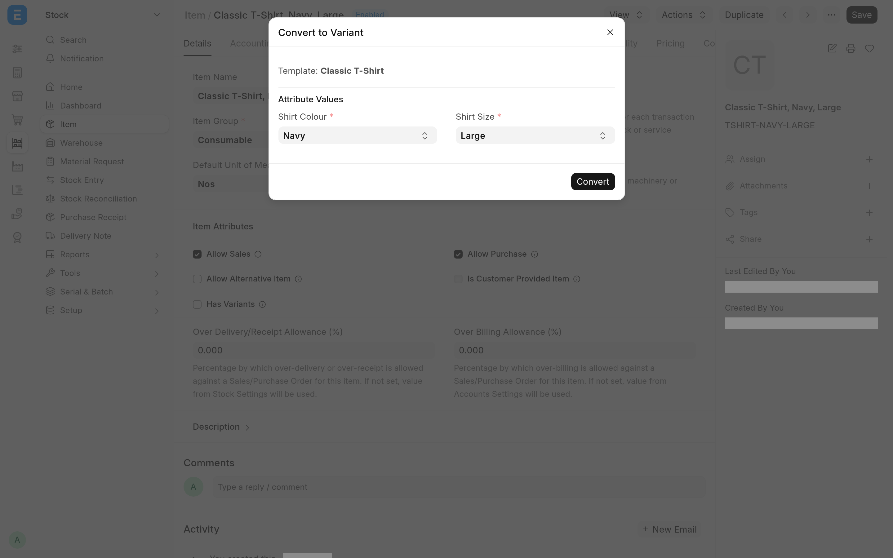

Frappe and ERPNext make some corrections hard on purpose. A duplicate Customer cannot be folded into another from its form, an Item cannot become a variant once it exists, and the clearance date of a submitted Payment Entry or Journal Entry cannot be edited. Data Steward adds a small set of tools for the administrator who cleans up real data and does need to make those changes.

Every tool is off until a System Manager enables it in **Data Steward Settings**, each one also needs a role and write permission on the document, and every change leaves a comment on the document it touched. Data Steward runs on Frappe v16 with ERPNext and is free software under the [MIT licence](../license.txt).

## What you get

### Bulk merge

A **Merge Selected** action in the list view of every DocType that allows renaming. Tick two or more records, pick the one to keep, and Frappe's own rename-and-merge folds the others into it. See [Merge duplicate records](merge-records.md).

### Convert an Item to a variant

**Actions → Convert to Variant** on the Item form makes an existing Item a variant of a template Item, with a value for each of the template's attributes. See [Convert an Item to a variant](convert-to-variant.md).

### Clearance date corrections

A **Set Clearance Date** button on a submitted Payment Entry, and **Actions → Manually Clear** and **Actions → Remove Clearance** on a submitted Journal Entry. A clearance date before the entry's cheque date is refused, as in ERPNext's Bank Clearance tool. See [Correct clearance dates](clearance-dates.md).

### Settings and an audit trail

One check box per tool in **Data Steward Settings**, all off after install. Each correction adds a comment to the document it changed, and the settings record their own changes. See [Configuration](configuration.md).

### A full-width desk

The desk uses the full width of the screen in a browser that has no width stored yet. This is the one part of the app that is not behind a setting, and it changes no data. See [Configuration](configuration.md#full-width-desk).

## Where to start

| You are                               | Read                                                                                 |
| ------------------------------------- | ------------------------------------------------------------------------------------ |
| The administrator setting it up       | [Install and upgrade](install.md), then [Configuration](configuration.md)            |
| A System Manager cleaning up records  | [Merge duplicate records](merge-records.md)                                          |
| An Item Manager fixing the item list  | [Convert an Item to a variant](convert-to-variant.md)                                |
| An Accounts Manager fixing clearances | [Correct clearance dates](clearance-dates.md)                                        |
| Anyone hitting an error               | [Limitations and troubleshooting](troubleshooting.md)                                |
| A developer changing the app          | [Development](development/README.md) and [How it works](development/architecture.md) |

## Requirements

- A bench with Frappe v16. The app declares `frappe >=16.0.0,<17.0.0`.
- ERPNext v16 (`erpnext >=16.0.0,<17.0.0`) on the same site. `hooks.py` lists it in `required_apps`, so install ERPNext first and Data Steward after it.
- A System Manager to switch the tools on, and users with the roles each tool needs: System Manager for bulk merge, Item Manager for Convert to Variant, Accounts Manager for the clearance tools.

> [!NOTE]
> These pages describe the code in the repository. Where a statement depends on Frappe's or ERPNext's own behaviour, it was checked against Frappe 16.52 and ERPNext 16.51.

## Source and changes

The source is at [github.com/Avunu/data_steward](https://github.com/Avunu/data_steward). Each release is listed on the [releases page](https://github.com/Avunu/data_steward/releases), and the [changelog](../CHANGELOG.md) lists every change.
