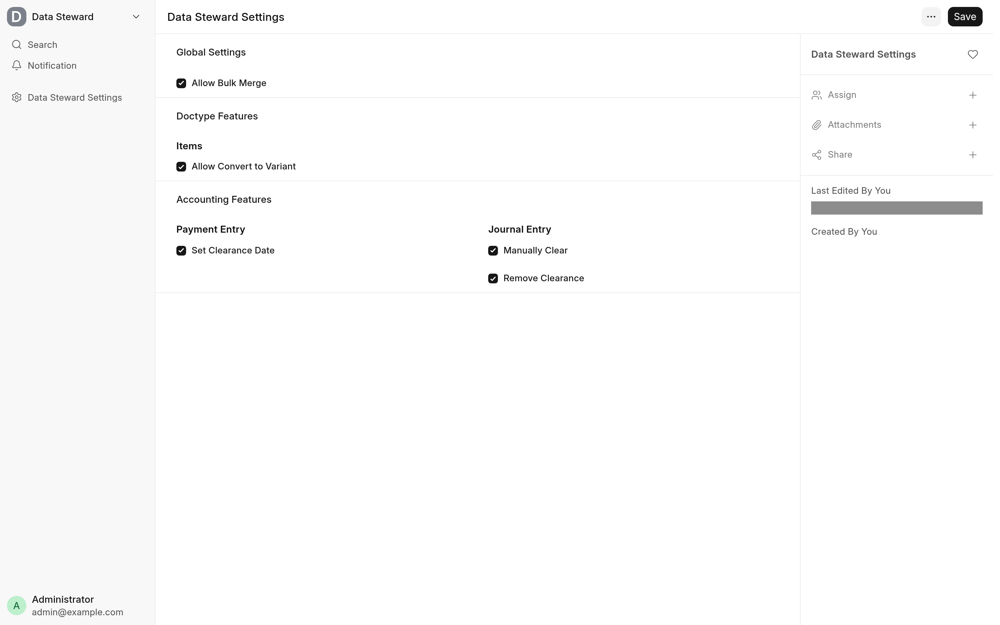

Data Steward is configured in one place, **Data Steward Settings**. Who may use an enabled tool is decided by roles and document permissions you already manage in Frappe. The app reads no `site_config.json` keys.

## Data Steward Settings

Open **Data Steward Settings** from the awesome bar as a System Manager, the only role with access to it. Tick only the tools you need. Each check box is off by default, including after install.

| Setting                      | Section                            | What it enables                                                           | Default |
| ---------------------------- | ---------------------------------- | ------------------------------------------------------------------------- | ------- |
| **Allow Bulk Merge**         | Global Settings                    | **Merge Selected** in the list view of every DocType that allows renaming | Off     |
| **Allow Convert to Variant** | Doctype Features, Items            | **Actions → Convert to Variant** on the Item form                         | Off     |
| **Set Clearance Date**       | Accounting Features, Payment Entry | **Set Clearance Date** on a submitted Payment Entry                       | Off     |
| **Manually Clear**           | Accounting Features, Journal Entry | **Actions → Manually Clear** on a submitted Journal Entry                 | Off     |
| **Remove Clearance**         | Accounting Features, Journal Entry | **Actions → Remove Clearance** on a submitted Journal Entry               | Off     |

When a tool is off, its button is not shown and its endpoint refuses every call with a permission error, so turning a setting off takes effect at once, also for a form that is already open. The settings track changes, so the document's version history shows who switched which tool on or off.

## Roles and permissions

An enabled tool still checks who is calling it. Each endpoint checks, in this order, that the tool is enabled, that the user has one of its roles, and that the user may write the document.

| Tool                             | Roles (any one)                  | Document permission                                                                                                             |
| -------------------------------- | -------------------------------- | ------------------------------------------------------------------------------------------------------------------------------- |
| Bulk merge                       | System Manager                   | Write on each record being merged and on the record kept, and delete on each record being merged (Frappe's rename checks these) |
| Convert to Variant               | Item Manager, System Manager     | Write on the Item                                                                                                               |
| Set Clearance Date               | Accounts Manager, System Manager | Write on the Payment Entry                                                                                                      |
| Manually Clear, Remove Clearance | Accounts Manager, System Manager | Write on the Journal Entry                                                                                                      |

The Administrator user passes every role check. The buttons are shown to anyone who can open the form or list while the tool is enabled; a user without the role gets an error when they use it. See [Limitations and troubleshooting](troubleshooting.md#troubleshooting).

## Full-width desk

The desk bundle sets Frappe's full-width layout on in a browser that has no layout stored yet, then leaves it alone. The choice is kept in the browser's local storage, the same place Frappe's own **Full Width** and **Compact** layout setting keeps it, so it applies per browser rather than per user. A user who switches back to **Compact** keeps that choice. There is no setting to turn this default off.

## What the app adds to your site

This is the complete list.

### DocTypes and fields

| What                  | Details                                                                                                                                    |
| --------------------- | ------------------------------------------------------------------------------------------------------------------------------------------ |
| Data Steward Settings | A Single DocType in the Data Steward module, with the five check boxes above. System Manager has full access to it; no other role has any. |

The app adds no custom fields, property setters, roles, workspaces, reports, print formats, scheduled jobs or `doc_events`, and overrides no server-side DocType class.

### Desk scripts

| Where           | Change                                                                                                                                                            |
| --------------- | ----------------------------------------------------------------------------------------------------------------------------------------------------------------- |
| Every desk page | `data_steward.bundle.js` (`app_include_js`): the capability helper the forms ask before they show a button, the list view override, and the full-width default.   |
| List views      | The desk's `ListView` class is extended to add **Merge Selected** to the **Actions** menu of DocTypes with **Allow Rename** set, when **Allow Bulk Merge** is on. |
| Item            | A form script (`doctype_js`) adds **Convert to Variant** under **Actions** on a saved Item.                                                                       |
| Payment Entry   | A form script adds **Set Clearance Date** on a submitted Payment Entry.                                                                                           |
| Journal Entry   | A form script adds **Manually Clear** and **Remove Clearance** under **Actions** on a submitted Journal Entry.                                                    |

### Whitelisted endpoints

All need a signed-in user. The ones that change data accept POST only and do not commit on their own: Frappe commits the request when it succeeds and rolls it back on an error.

| Method                                                                              | What it does                                                                  |
| ----------------------------------------------------------------------------------- | ----------------------------------------------------------------------------- |
| `data_steward.api.check_capability`                                                 | Returns whether a tool is enabled. The desk calls it before showing a button. |
| `data_steward.api.assert_capability`                                                | Raises a permission error when a tool is off                                  |
| `data_steward.data_steward.hooks.bulk_merge`                                        | Merges records with Frappe's `bulk_rename` (POST)                             |
| `data_steward.data_steward.hooks.item.convert_to_variant`                           | Makes an Item a variant of a template (POST)                                  |
| `data_steward.data_steward.hooks.payment_entry.set_clearance_date`                  | Sets a Payment Entry's clearance date (POST)                                  |
| `data_steward.data_steward.hooks.journal_entry.manually_clear_journal_entry`        | Sets a Journal Entry's clearance date from its Bank Transaction (POST)        |
| `data_steward.data_steward.hooks.journal_entry.remove_clearance_date_journal_entry` | Clears a Journal Entry's clearance date (POST)                                |

The settings module, `data_steward.data_steward.doctype.data_steward_settings.data_steward_settings`, whitelists its own `check_capability` and `assert_capability` too; the ones in `data_steward.api` call them.

## Related

- [Install and upgrade](install.md)
- [How it works](development/architecture.md) for the code behind each tool
